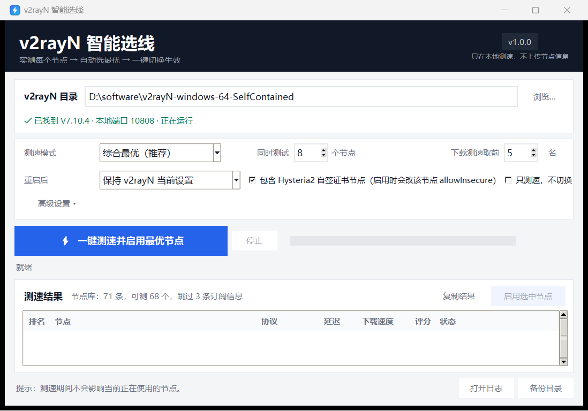

# v2rayN 智能选线（V2rayN SmartRoute）

给已有的 v2rayN 做的一个“一键选最优线路”小工具：读取节点库，真实测延迟和下载速度，自动选出综合最好的节点，重启 v2rayN 并启用它。



> 已在 v2rayN 7.10.4（Windows x64）上实测通过，包括 Xray 节点和 Hysteria2 节点的切换与失败回滚。

## 下载

普通用户请到 [Releases](../../releases) 下载最新的 `V2rayN-SmartRoute-v*.zip`，解压后双击 `V2rayN-SmartRoute.exe` 即可，不需要安装 Python。

---

## 1. 它能做什么

- 读取 v2rayN 当前节点库，跳过“剩余流量 / 套餐到期”等订阅信息行。
- 为每个支持的节点临时启动 Xray 或 sing-box，通过本地 SOCKS 端口做真实 HTTPS 请求，测量延迟。
- 对延迟最快的前几个节点做下载测速。
- 默认按 **55% 延迟 + 45% 速度** 计算综合分，也可以改成“延迟最低”或“速度最快”。
- 关闭 v2rayN → 备份配置和数据库 → 写入选中节点 → 重启 → 用新节点做一次真实 HTTPS 验证。
- 如果新节点启动失败或实测不可用，自动恢复原配置、原节点并重新启动 v2rayN。

测速期间使用随机本地端口和临时核心，不会影响当前正在使用的代理；只有最后“切换并重启”的十几秒会短暂断网。

---

## 2. 运行环境

- Windows 10 / 11 x64。
- 已安装 v2rayN 7.x，并且 `v2rayN.exe`、`guiConfigs\guiNDB.db` 存在。
- 首次运行需要联网（测速会访问 Google / Cloudflare 的 204 地址和测速地址）。
- 不需要安装 Python；程序是打包好的独立目录。

---

## 3. 快速使用

1. 双击 `V2rayN-SmartRoute.exe`。
2. 程序一般会自动找到 v2rayN；如果没有，点“浏览”选择 `v2rayN.exe` 所在的文件夹。
3. 选择测速模式（默认“综合最优（推荐）”）。
4. 点 **“⚡ 一键测速并启用最优节点”**。
5. 等待约 1～2 分钟（节点多、网络差时会更久）。程序会显示每个节点的延迟、速度和状态。
6. 测速完成后会自动重启 v2rayN 并启用最优节点；看到“已启用”即完成。
7. 如果只想看结果、不想切换，勾选“只测速，不切换”；测完后也可以在结果列表里选中某个节点，点“启用选中节点”手动切换。

程序不会常驻后台，也不会开机自启；关闭窗口即退出。

---

## 4. 界面选项

| 选项 | 说明 |
| --- | --- |
| 综合最优（推荐） | 延迟 55% + 速度 45%，兼顾打开网页和下载。 |
| 延迟最低 | 只按延迟排序，适合网页、聊天、游戏。 |
| 速度最快 | 更看重下载速度，适合看视频、下载。 |
| 并发数 | 同时测试的节点数。网络不稳定时建议降到 4～6。 |
| 测速候选数 | 延迟测试后，对最快的前 N 个节点做下载测速。设为 0 可只测延迟。 |
| 包含 Hysteria2 自签证书节点 | 允许测试并启用使用自签证书的 Hysteria2/TUIC 节点。关闭后这类节点会测速失败并被跳过。 |
| Windows 系统代理 | 默认“保持 v2rayN 当前设置”；也可以强制开启或关闭。 |
| 只测速，不切换 | 只更新结果列表和节点库统计，不重启 v2rayN。 |
| 高级设置 | 自定义延迟 URL、备用 URL、下载测速 URL 和超时。 |

---

## 5. 关于 sing-box 兼容核心（重要）

v2rayN 7.10.4 生成 Hysteria2/TUIC 配置时，仍在用旧版 sing-box 的写法：

- 旧版 DNS：`dns.servers[].address`
- `dns` 特殊出站
- inbound 的 `sniff` / `sniff_override_destination`

这些字段在 **sing-box 1.13.0** 中已经被移除。v2rayN 7.10.4 自带的 sing-box 1.13.16 会拒绝启动它自己生成的 Hysteria2 配置，表现为“核心启动失败”，节点也就无法启用。

本程序的处理方式：

1. 程序目录自带官方 **sing-box 1.12.9**（`vendor\sing-box-1.12.9.exe`，SHA-256 已记录在 `vendor\README.txt`）。
2. 当你启用 Hysteria2/TUIC 节点，而 v2rayN 当前的 sing-box 是 1.13+（或低于 1.12）时：
   - 先正常关闭 v2rayN；
   - 把原核心备份到 `%LOCALAPPDATA%\V2rayNSmartRoute\core-backups\`；
   - 用 1.12.9 替换 `v2rayN\bin\sing_box\sing-box.exe`；
   - 启动 v2rayN 时附加兼容环境变量（只对该进程生效，不修改系统环境变量）：
     - `ENABLE_DEPRECATED_LEGACY_DNS_SERVERS=true`
     - `ENABLE_DEPRECATED_SPECIAL_OUTBOUNDS=true`
   - 重启并验证节点。
3. Xray 节点完全不受影响；sing-box 核心只影响 Hysteria2/TUIC 等由 sing-box 运行的节点。
4. 如果以后 v2rayN 自动更新又把核心换回 1.13+，下次启用 Hysteria2 时程序会再次自动处理。

> 这是目前让 v2rayN 7.10.4 正常使用 Hysteria2 的必要兼容处理。替换前一定会备份原核心；备份目录里还有 `history.jsonl` 记录版本和哈希。

### 如果想恢复原核心

1. 退出 v2rayN 和本程序。
2. 打开 `%LOCALAPPDATA%\V2rayNSmartRoute\core-backups\`，找到类似 `sing-box-1.13.16-xxxxxxxxxxxx.exe` 的文件。
3. 把它复制回 `你的v2rayN目录\bin\sing_box\sing-box.exe`。
4. 重新启动 v2rayN。

恢复后 Hysteria2 可能再次无法启动；一般只在卸载本工具或排查问题时才需要恢复。

---

## 6. 数据、备份与日志

| 内容 | 位置 |
| --- | --- |
| 程序设置 | `%LOCALAPPDATA%\V2rayNSmartRoute\settings.json` |
| v2rayN 配置/数据库备份 | `%LOCALAPPDATA%\V2rayNSmartRoute\backups\<时间戳>\` |
| 失败现场（生成的配置、v2rayN 日志） | `...\backups\<时间戳>\diagnostics\` |
| sing-box 原核心备份 | `%LOCALAPPDATA%\V2rayNSmartRoute\core-backups\` |
| 运行日志 | `%LOCALAPPDATA%\V2rayNSmartRoute\logs\smartroute.log` |

- 每次切换前都会备份 `guiNConfig.json` 和 `guiNDB.db`（含 `-wal`/`-shm`）。
- 默认只保留最近 10 份配置备份；核心备份按“版本 + 哈希”保留，不会重复堆积。
- 切换失败时会自动回滚，并把现场文件留在 `diagnostics` 里，方便排查是节点问题还是核心问题。

---

## 7. 自签证书说明

部分 Hysteria2 节点使用自签证书。测速时程序会先按严格证书验证，失败后再允许不安全证书重试一次；如果该节点最终被选中，会弹窗确认，并且只把这个节点的 `AllowInsecure` 改为 `true`。

- 这是节点本身证书不受信任，不是目标网站证书问题。
- 如果不希望使用这类节点，取消勾选“包含 Hysteria2 自签证书节点”即可。
- 程序不会全局关闭证书验证。

---

## 8. 常见问题

**找不到 v2rayN**
点“浏览”，选择包含 `v2rayN.exe` 的文件夹（不是 `bin` 子目录）。

**提示端口被占用 / 启动失败**
先退出其他代理客户端（Clash、sing-box GUI 等），确认 v2rayN 的本地端口（默认 10808）没有被占用。程序在切换前会等待端口释放，仍失败时会回滚。

**测速很多节点失败**
订阅过期、节点失效、机场限速或本地网络波动都会导致失败。失败的节点不会参与最终选择；可以降低并发数后重试。订阅里的“套餐到期”等提示行会被自动跳过。

**切换后节点不可用**
程序会自动回滚并重新启用原节点。可以在 `backups\<时间戳>\diagnostics\` 查看 v2rayN 生成的配置和日志；通常是节点已失效，重新测速换一个即可。

**Hysteria2 仍然启动失败**
确认程序目录下存在 `_internal\vendor\sing-box-1.12.9.exe`（或 `vendor\sing-box-1.12.9.exe`）。如果 v2rayN 正在运行且核心文件被占用，先手动退出 v2rayN 再重试。

**Windows 提示“未知发布者”**
程序没有代码签名，SmartScreen 可能提示。确认文件来源可信后选择“仍要运行”。部分杀毒软件可能对 PyInstaller 打包的程序误报，可加入信任。

**系统代理没有生效**
本程序默认“保持 v2rayN 当前设置”。如果 v2rayN 里系统代理是关闭的，可以在本程序里选“开启 Windows 系统代理”，或直接在 v2rayN 里开启。

---

## 9. 卸载

1. 退出本程序和 v2rayN。
2. 删除本程序所在文件夹（例如 `D:\Tools\v2rayN-SmartRoute`）。
3. 删除桌面快捷方式。
4. 如需清理设置、备份和日志，删除 `%LOCALAPPDATA%\V2rayNSmartRoute`。
5. 如需恢复 sing-box 原核心，按第 5 节的步骤操作。

本程序不会卸载或修改 v2rayN 的程序文件（除了上述 sing-box 核心替换）；节点库和配置在切换前都有备份。

---

## 10. 文件说明

```
V2rayN-SmartRoute.exe        主程序
_internal\                   运行依赖（含 vendor\sing-box-1.12.9.exe、assets\app.ico）
README.md                    本说明
使用说明.txt                  快速上手
```

---

## 11. 从源码运行 / 构建

运行源码不需要第三方依赖（Python 3.10+，含 Tkinter）：

```powershell
git clone https://github.com/Chen11-031/v2rayN-SmartRoute.git
cd v2rayN-SmartRoute
python app.py
```

打包成独立目录：

```powershell
python -m venv .venv
.venv\Scripts\python.exe -m pip install -r requirements-dev.txt
powershell -ExecutionPolicy Bypass -File tools\build.ps1
```

打包结果在 `dist\V2rayN-SmartRoute\`。

仓库默认不提交 36 MB 的 `vendor\sing-box-1.12.9.exe`。首次打包时 `build.ps1` 会自动调用 `tools\fetch_singbox.ps1`，从官方 Release 下载并校验 SHA-256；也可以手动运行：

```powershell
powershell -ExecutionPolicy Bypass -File tools\fetch_singbox.ps1
```

## 12. 许可证与声明

- 本工具用于管理你自己的 v2rayN 节点，请遵守当地法律法规和节点服务商的使用条款。
- 随程序附带的 sing-box 1.12.9 以 **GPLv3** 发布，许可证声明见 `_internal\vendor\LICENSE.sing-box.txt`（GPLv3 全文：https://www.gnu.org/licenses/gpl-3.0.html）；对应源代码：https://github.com/SagerNet/sing-box/tree/v1.12.9；来源和 SHA-256 见 `_internal\vendor\README.txt`。本程序附带的是官方发布包，未修改 sing-box 二进制。
- 本工具按“现状”提供，不提供任何明示或暗示的担保；因节点、网络或第三方软件变更造成的损失由使用者自行承担。
